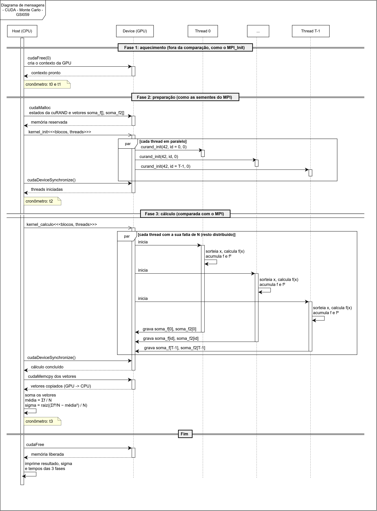

# **Explicação do diagrama de sequência que ilustra a nossa paralelização utilizando CUDA para o Monte Carlo Simples**

   

**Escopo de cálculo**

Assim como no trabalho anterior, esse trabalho calcula a área embaixo da curva f(x) = 1 / (1 + x²), com x no intervalo de 0 a 1, cujo valor exato corresponde a π/4, isto é, 0,785398. Esse valor continua servindo de referência para conferir se os resultados do Monte Carlo estão próximos do correto.

A diferença é que, dessa vez, o cálculo é feito na placa de vídeo (GPU), utilizando CUDA, a plataforma da NVIDIA para programar a GPU. Como a rotina gsl_monte_plain_integrate da *GNU Scientific Library* (GSL) foi feita para rodar na CPU, ela não pode ser executada na GPU. Por isso, o Monte Carlo simples foi implementado diretamente em CUDA, seguindo os mesmos 4 passos: sortear x, calcular f(x), tirar a média das alturas e multiplicar pela largura do intervalo.

**Conceitos de CUDA utilizados**

Em CUDA, o computador é dividido em duas partes. O *host* é a CPU, que executa o main e comanda o programa. O *device* é a GPU, que realiza o cálculo pesado quando o host solicita. Cada um possui a sua própria memória, e uma não enxerga a da outra. Por isso, os dados precisam ser copiados entre elas, o que tem custo de tempo.

A função que roda na GPU é chamada de *kernel*. Quando o host a lança, ela não é executada uma única vez, mas sim milhares de vezes ao mesmo tempo, uma em cada *thread*. As threads são agrupadas em blocos, e o conjunto de todos os blocos forma o *grid*. Cada thread possui um número único, o id, calculado a partir do número do seu bloco e da sua posição dentro dele. O id tem o mesmo papel que o rank tinha no MPI.

**Por que paralelizar na GPU?**

Cada ponto continua sendo sorteado e calculado sem depender de nenhum outro. Logo, os N pontos são divididos entre as threads, e cada uma calcula a sua fatia, todas simultaneamente. Trata-se, novamente, de paralelismo de dados, mas agora com milhares de threads em vez de alguns processos.

Quando N não é divisível pelo número de threads, algumas threads calculam um ponto a mais. No MPI, exigimos N divisível por P porque a GSL devolvia a média de cada processo, e combinar médias de tamanhos diferentes exigiria média ponderada. No CUDA, as threads devolvem somas, e a divisão por N acontece uma única vez no host. Desse modo, o resto da divisão não afeta o resultado.

**O uso da semente**

No trabalho anterior, cada processo utilizava uma semente distinta, igual a 42 + rank. Na apresentação, o professor observou que essa forma não é a mais rigorosa. Tendo isso em vista, definiu-se que todas as threads utilizam a mesma semente, 42, mas cada uma começa em um trecho diferente da sequência de números aleatórios, indicado pelo seu id. Isso é feito com a biblioteca cuRAND, da própria NVIDIA, por meio da função curand_init(42, id, 0).

Cada trecho possui cerca de 2⁶⁷ números, enquanto cada thread utiliza apenas alguns milhares. Assim, nenhuma thread sorteia os números de outra. Os resultados continuam reprodutíveis, pois a semente é fixa.

**O resultado e o erro**

A GSL devolvia o resultado e o sigma prontos. Como ela não é utilizada na GPU, cada thread acumula duas somas: a soma das alturas f(x) e a soma dos seus quadrados, f(x)². A primeira fornece a média, que é o resultado. A segunda permite calcular o quanto as alturas variam em torno da média, o que dá o sigma. É a mesma ideia do vetor de 2 posições enviado no MPI_Reduce.

**Medição do tempo**

A execução é dividida em 3 fases, medidas separadamente na mesma execução, com o mesmo relógio da versão serial (clock_gettime):

1. **Aquecimento:** a primeira chamada CUDA cria o contexto da GPU, preparação interna que pode levar décimos de segundo. Equivale ao MPI_Init e fica fora da comparação.
2. **Preparação:** reserva da memória na GPU e posicionamento de cada thread no seu trecho da cuRAND. Equivale à definição das sementes no MPI.
3. **Cálculo:** do lançamento do kernel até a soma final pronta no host. Equivale ao trecho medido no MPI, da integração até o fim do MPI_Reduce, e é o tempo comparado com as versões serial e MPI.

Somando as fases, também é possível ver quanto custa a execução completa, incluindo o aquecimento.

**Passo a passo do diagrama**

O diagrama evidencia o host, o device e algumas threads (a coluna "..." representa todas as threads intermediárias), com o tempo correndo de cima para baixo.

1. **cudaFree(0):** o host cria o contexto da GPU (fase 1).
2. **cudaMalloc:** o host reserva, na memória da GPU, os estados da cuRAND e os vetores soma_f e soma_f2, onde cada thread gravará as suas somas.
3. **kernel_init:** o host lança o kernel de preparação, e cada thread executa curand_init(42, id, 0).
4. **cudaDeviceSynchronize:** o host espera todas as threads terminarem. Como o lançamento de um kernel não espera a GPU, essa chamada é necessária para que o cronômetro seja lido só depois do fim da preparação (fase 2).
5. **kernel_calculo:** o host lança o kernel de cálculo. Cada thread processa a sua fatia de pontos: sorteia x, calcula f(x) e acumula f e f².
6. **Grava as somas:** cada thread grava as suas duas somas nos vetores, na posição do seu id. Como cada uma escreve numa posição diferente, as gravações acontecem em paralelo, sem conflito.
7. **cudaDeviceSynchronize:** o host espera o cálculo terminar.
8. **cudaMemcpy:** o host copia os vetores da memória da GPU para a memória da CPU.
9. **Soma e calcula média e erro:** o host soma os vetores e calcula a média (soma de f ÷ N) e o sigma (raiz de (soma de f² ÷ N − média²) ÷ N). Aqui o cronômetro é lido pela última vez, encerrando a fase 3.
10. **cudaFree:** o host libera a memória da GPU e imprime o resultado, o sigma e o tempo de cada fase.

**Precisão**

A comparação principal é feita em *double*, a mesma precisão da GSL e da versão MPI. Também é testada uma versão mista, em que o sorteio e o cálculo de f(x) são feitos em *float* e as somas em *double*. Placas de vídeo comuns, como a GTX 1660, realizam contas em double muito mais devagar do que em float, e essa comparação mostra o quanto isso influencia o desempenho. A versão totalmente em float foi descartada porque, com bilhões de pontos, o erro de arredondamento acumulado nas somas poderia ficar maior que o próprio sigma.

**A hipótese do professor**

O professor levantou a hipótese de que esse tipo de código tende a ter desempenho pior na GPU. Os motivos que serão investigados são a lentidão das placas comuns em double, os custos fixos que a GPU possui e a CPU não (contexto, preparação da cuRAND e cópia dos resultados) e o maior peso desses custos quando N é pequeno. Por outro lado, são milhões de sorteios independentes realizando a mesma conta, que é justamente o tipo de trabalho em que a GPU é forte. Por isso, a resposta virá das medições.

As notações utilizadas, conforme padrão UML e documentação da IBM (https://www.ibm.com/docs/pt-br/rsas/7.5.0?topic=diagrams-messages-in-uml), foram:

* **Setas de ponta cheia:** representam chamadas síncronas, em que o host espera a resposta da GPU, e operações locais de um participante consigo mesmo.
* **Setas de ponta aberta:** representam o lançamento dos kernels, que é assíncrono, isto é, o host lança e segue, sem esperar a GPU terminar.
* **Setas tracejadas:** representam as respostas da GPU ao host.
* **Barras de ativação:** retângulos finos sobre as linhas de vida, que indicam o período em que cada participante está trabalhando.
* **Fragmento par:** retângulo que indica que os trechos dentro dele são executados em paralelo, sem ordem definida entre as threads.
* **Notas:** retângulos com o canto dobrado, usados para indicar os momentos de leitura do cronômetro.
* **Divisores:** faixas horizontais que separam as 3 fases da execução.